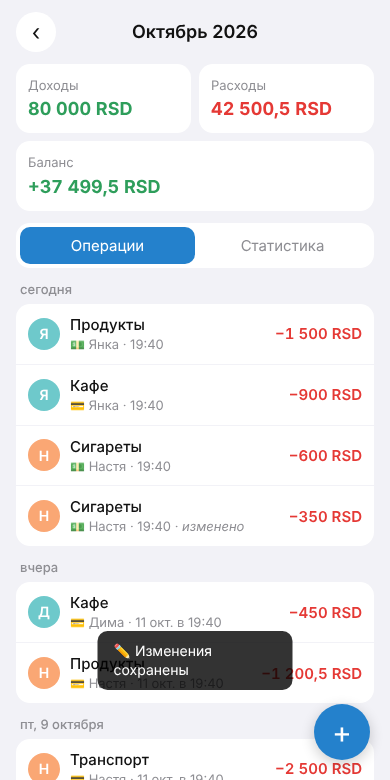
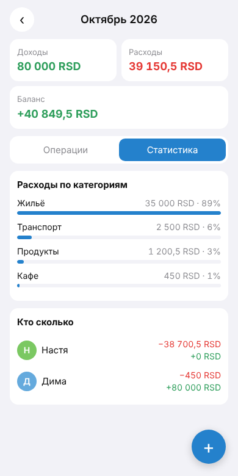
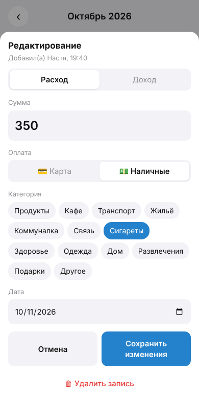

# 💸 Бюджет на двоих — Telegram Mini App

Мини-приложение внутри Telegram для совместного учёта доходов и расходов двух человек.
Оба видят одну и ту же базу, а бот сразу пишет второму участнику, когда первый что-то добавил.
**Без своего сервера**: интерфейс на GitHub Pages, бэкенд на Cloudflare Workers, база в Cloudflare D1 — всё на бесплатных тарифах.

| Операции | Статистика | Редактирование |
|---|---|---|
|  |  |  |

## Возможности

- **Mini App** в Telegram: доходы/расходы по месяцам, баланс, список по дням с отметкой, **кто и во сколько** добавил запись, статистика по категориям и по людям.
- **Редактирование**: нажмите на запись — откроется форма с её данными; можно поменять сумму, категорию, способ оплаты, тип и дату или удалить запись. Автор записи сохраняется, в списке появляется пометка «изменено», а второму участнику бот пишет, что именно поменялось.
- **Карта / наличные**: у каждой операции есть способ оплаты; в статистике — сколько ушло с карты и наличными (последний выбор запоминается).
- **Экспорт в Excel**: кнопка во вкладке «Статистика» или команда `/export` — бот присылает файл `.xlsx` (лист «Операции» с фильтрами и итогами + лист «Итоги» по категориям и людям).
- **Синхронизация на двоих**: общая база в облаке + автообновление экрана каждые 15 секунд и при возврате в приложение.
- **Уведомления партнёру** через бота: «💸 Настя: расход 1 200 RSD — Продукты».
- **Быстрый ввод сообщением боту**, без открытия приложения:
  - `500 кафе` — расход в категории «Кафе»
  - `350 сигареты` (или `350 сиги`) — расход
  - `+80000 зарплата` — доход
  - `500 кафе нал` или `500 нал кафе` — оплачено наличными (также понимает `наличные`, `налик`, `кэш`); без пометки — карта
  - если категория не распознана, запись попадёт в «Другое»
- `/balance` — итоги месяца текстом.
- `/export` — таблица за текущий месяц, `/export 2026-09` — за выбранный, `/export all` — за всё время.
- Подстраивается под светлую/тёмную тему Telegram.
- **Безопасность**: каждый запрос к API проверяется по подписи Telegram (`initData` + HMAC-SHA256 токеном бота), доступ только у двух ID из белого списка, токен бота хранится только в секретах.

## Как это устроено

```
 Telegram (оба участника)
   │  открывает Mini App                 │  пишет боту «500 кафе»
   ▼                                     ▼
 GitHub Pages ── fetch + initData ──▶ Cloudflare Worker ◀── webhook ── Telegram Bot API
 (HTML/CSS/JS)                          │   ▲                              ▲
                                        ▼   │                              │
                                   Cloudflare D1 (SQLite)      уведомление партнёру
```

> **Почему не только GitHub Pages.** Pages раздаёт лишь статичные файлы — хранить общие данные и запускать бота он не умеет. `CloudStorage` в Telegram у каждого пользователя свой, а токен бота в JS-коде страницы увидел бы любой. Поэтому данные и проверка доступа живут в Cloudflare Worker.

```
webapp/                 — Mini App (публикуется на GitHub Pages)
  index.html, app.js, style.css
  config.js             — адрес API; при деплое перезаписывается автоматически
worker/                 — бэкенд на Cloudflare Workers
  src/index.js          — маршруты API, webhook, CORS
  src/auth.js           — проверка подписи initData (WebCrypto)
  src/bot.js            — команды бота, быстрый ввод, уведомления, настройка webhook
  src/export.js         — сборка таблицы и отправка файлом в чат
  src/xlsx.js           — генератор .xlsx (zip через fflate)
  src/db.js             — запросы к D1
  src/money.js          — суммы храним целыми «копейками», без ошибок float
  src/config.js         — категории, список разрешённых ID, часовой пояс
  migrations/           — схема базы
  test/                 — тесты (npm test)
  wrangler.toml         — настройки Worker
.github/workflows/deploy.yml — автодеплой Worker + Pages при каждом push в main
```

## Установка (один раз, ~15 минут, ничего ставить на компьютер не нужно)

### 1. Бот в Telegram
1. Напишите [@BotFather](https://t.me/BotFather) → `/newbot` → придумайте имя и username (должен заканчиваться на `bot`).
2. Скопируйте **токен** вида `1234567890:AAAA...`. Это пароль от бота — никому не показывайте.
3. Узнайте Telegram ID обоих участников: каждый пишет [@userinfobot](https://t.me/userinfobot) и получает число `Id`.

### 2. Cloudflare
1. Зарегистрируйтесь на [dash.cloudflare.com](https://dash.cloudflare.com/sign-up) (бесплатно, карта не нужна).
2. Откройте слева **Workers & Pages** один раз — Cloudflare создаст ваш поддомен `*.workers.dev` (если попросит выбрать имя — выберите любое).
3. Скопируйте **Account ID**: он справа на странице Workers & Pages (или в адресной строке: `dash.cloudflare.com/<это_и_есть_ID>/...`).
4. Создайте **API-токен**: значок профиля → **My Profile → API Tokens → Create Token** → шаблон **Edit Cloudflare Workers** → *Use template*.
   В блоке *Permissions* нажмите **+ Add more** и добавьте: `Account` · `D1` · `Edit`.
   В *Account Resources* выберите свой аккаунт → **Continue to summary → Create Token** → скопируйте токен (он покажется один раз).

### 3. GitHub
В репозитории:
1. **Settings → Pages → Build and deployment → Source: GitHub Actions**.
2. **Settings → Secrets and variables → Actions → New repository secret** — добавьте 4 секрета:

| Имя | Значение |
|---|---|
| `BOT_TOKEN` | токен от BotFather |
| `ALLOWED_USER_IDS` | два ID через запятую, например `123456789,987654321` |
| `CLOUDFLARE_API_TOKEN` | токен Cloudflare из шага 2.4 |
| `CLOUDFLARE_ACCOUNT_ID` | Account ID из шага 2.3 |

3. **Actions → Deploy → Run workflow** (или *Re-run all jobs* у последнего запуска).
   Через 2–3 минуты оба шага станут зелёными ✅. Workflow сам создаст базу, выложит Worker, подключит webhook бота, добавит кнопку «Бюджет» и опубликует Mini App по адресу `https://<логин>.github.io/tg-budget/`.

### 4. Пользоваться
Оба участника открывают бота и жмут `/start`. Слева от поля ввода появится кнопка **«Бюджет»**.
Важно, чтобы второй участник хотя бы раз нажал `/start` — иначе бот не сможет присылать ему уведомления.

## Обслуживание

- **Обновить приложение** — любой push в `main` пересобирает и выкладывает всё автоматически.
- **Сменить участников** — поменяйте секрет `ALLOWED_USER_IDS` и запустите *Run workflow*.
- **Сменить валюту / часовой пояс** — `CURRENCY` и `TIMEZONE` в `worker/wrangler.toml`.
- **Посмотреть данные / сделать бэкап** — Cloudflare → Storage & Databases → D1 → `tg-budget` → Console, или с компьютера:
  ```bash
  npx wrangler d1 export tg-budget --remote --output backup.sql   # выгрузить всю базу в SQL-файл
  ```
- **Логи Worker** — Cloudflare → Workers & Pages → `tg-budget` → Logs.

### Если что-то не работает
| Симптом | Причина и решение |
|---|---|
| Workflow: «Не заданы секреты» | Добавьте все 4 секрета (шаг 3.2) и перезапустите |
| Workflow падает на D1 / Authentication error | У API-токена нет права `D1 · Edit` или выбран не тот аккаунт |
| «Не нашёл адрес *.workers.dev» | Откройте Workers & Pages в Cloudflare, чтобы создать поддомен |
| Pages: «Get Pages site failed» | Не включён Source: GitHub Actions (шаг 3.1) |
| В приложении «Доступ закрыт. Ваш ID: …» | Добавьте этот ID в `ALLOWED_USER_IDS` и перезапустите workflow |
| Бот молчит | Проверьте `BOT_TOKEN`; в логе шага «Настроить бота» должно быть `"ok":true` |

## Локальная разработка

```bash
cd worker
npm install                                   # ставит wrangler (CLI Cloudflare) локально в проект
cp .dev.vars.example .dev.vars                # тестовые секреты для локального запуска
npm run db:local                              # создать локальную копию базы
npm run dev                                   # Worker на http://localhost:8787
npm test                                      # тесты подписи, сумм и разбора сообщений
```
`webapp/config.js` по умолчанию смотрит на `http://localhost:8787`; интерфейс можно открыть через `python3 -m http.server` из папки `webapp`.

## API

Все запросы `/api/*` требуют заголовок `X-Telegram-Init-Data` (его подставляет Mini App).

| Метод | Путь | Что делает |
|---|---|---|
| GET | `/api/meta` | валюта, категории, текущий пользователь |
| GET | `/api/month?month=2026-10` | операции и сводка за месяц |
| POST | `/api/transactions` | добавить `{kind, amount, category, method: "card" \| "cash", date}` |
| POST | `/api/export` | прислать Excel в чат с ботом `{period: "2026-10" \| "all"}` |
| PUT | `/api/transactions/{id}` | изменить операцию (те же поля, что при добавлении) |
| DELETE | `/api/transactions/{id}` | удалить операцию |
| POST | `/tg/webhook` | входящие сообщения от Telegram (с секретным заголовком) |
| GET | `/health` | проверка, что Worker жив |

## Идеи для развития
- Лимиты по категориям с предупреждением в боте.
- Несколько валют с курсом (RSD/EUR).
